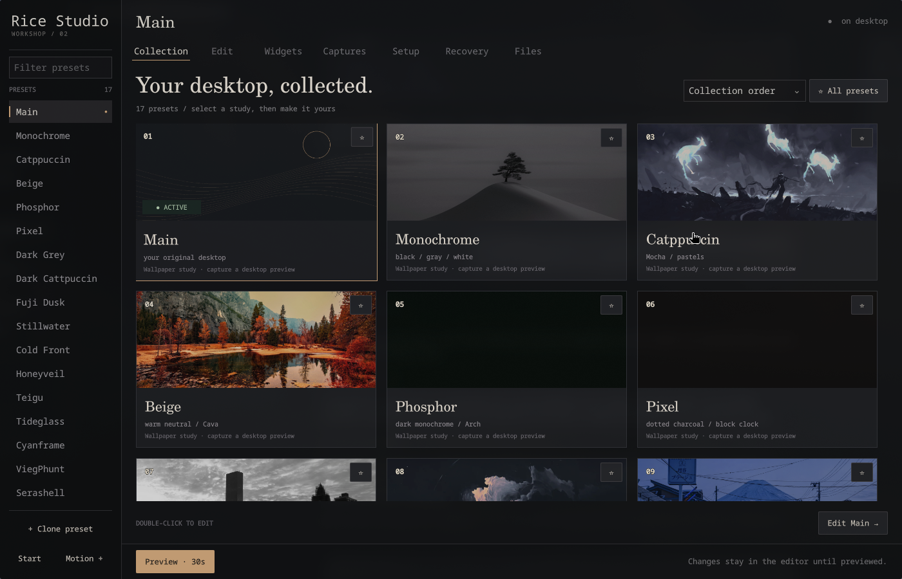

<div align="left">

# Rice Studio
### A desktop workshop for Arch, Hyprland and Serpantinum.

**Workshop 02 · theme collection beta**

Browse a collection, tune the details, capture it in motion, and return to your own desktop.



</div>

## Before installing

This beta ships the **16 original desktop rices** and your own Main. The collection uses the actual wallpapers, Waybar styles, Kitty and Fastfetch files, and the bundled native components. Serashell uses its own Quickshell panel. Tideglass includes its animated wallpaper.

The installer is intended for Arch + Hyprland, with Serpantinum recommended for the shared settings, weather and notification actions. Personal Main settings, recordings, and machine credentials are excluded from the bundle.

Tested on Arch, Hyprland 0.57.0 (Lua), Quickshell 0.3.2, Qt 6.12. Older config providers have an adapter but are not live-tested. Use a current Arch + Hyprland session; this is a beta, not a universal desktop installer.

## Install

Private repository: the owner must grant your GitHub account access first. With GitHub CLI authenticated:

```bash
gh repo clone jackolantern656787-cmd/rice-studio
cd rice-studio
./install.sh --deps
./install.sh --check
./install.sh --install
~/.local/bin/rice-studio
```

Alternatively download the source ZIP through GitHub, extract it, and run the last four commands from that directory.

`--deps` explicitly invokes **sudo pacman -Syu --needed** for the documented package set. It performs a full Arch system upgrade; inspect the transaction before accepting. The installer itself runs **without sudo**, downloads nothing, does not run third-party installers, and leaves your current desktop active.

The dependency command includes Waybar, Wofi, Cava, Fastfetch, Starship and the fonts used by most themes. Check **Setup** for available commands and the Serpantinum bar hook.

## Serpantinum bar switching

If Setup shows the bar hook as connected, Studio hides the Serpantinum bar only after the theme bar appears and restores it when you go back to Main.

For a compatible stock Serpantinum installation without the hook, run this after installing Studio:

```bash
python3 ~/.local/share/rice-studio-portable/serpantinum_hook.py --install
```

This optional hook backs up and edits only Serpantinum's `Shell.qml` and `bar/Bar.qml`. It checks for the expected layout before writing. Reopen Studio and check Setup after Quickshell reloads. Without the hook the original panel can remain visible alongside the theme bar.

Restore the two original files with the same command using `--restore`.

## What you get

- Screenshot-led collection, search, sort, favorites, keyboard navigation.
- Appearance editor: wallpaper, corner geometry, palette, native-panel font, and Studio Terminal palette selection.
- Drag/resize optional clock, calendar, CPU, RAM, music, and notes widgets.
- Private local screenshots and 8-second silent recordings after a countdown.
- Image/video imports, looping playback, preset notes, dependency checks.
- Independent timed-preview watchdog: close the UI and rollback still works.
- Checkpoints, personal Main, and a terminal recovery command.
- Reduced motion and rectangular controls with eased hover/pressed feedback.

The preset bar opens its included launcher where available. Themes using the original machine's Zunder setup fall back to the recipient's existing Serpantinum launcher or Wofi. Studio applies the original frame colors and corner styles through Hyprland. The recipient's window behavior and keybindings control window placement. Some panel actions depend on local services such as NetworkManager, MPRIS, and Serpantinum. Fuji Dusk uses a system font fallback when Anurati is unavailable.

Terminal profiles apply through:

```bash
~/.local/bin/rice-studio-terminal
```

## Main is yours

At first install, Studio reads the original compositor values it can change: gaps, border size/color, and corner radius. It saves them once in `~/.local/state/rice-studio-portable/original-main.json`.

Your existing wallpaper and bar daemons keep running. Studio adds its own wallpaper and panel layers. Main removes those layers, restores the saved compositor values and returns the Serpantinum bar to its starting state when the hook is available. The optional hook is the only change to existing Serpantinum source files.

Upgrades preserve this original baseline. Invalid or incomplete Main data stops installation instead of silently recapturing a themed desktop. This is not a full-system backup.

## Recovery / uninstall

```bash
~/.local/bin/rice-studio-recover
```

This restores personal Main. If a component crashes, your original desktop processes still exist underneath. In a new login your normal Hyprland configuration loads as usual; this beta does not modify autostart or automatically reapply a rice.

From the cloned repository:

```bash
python3 uninstall.py --uninstall
```

Uninstall restores Main first, stops **only this edition's explicitly scoped Quickshell instances**, and removes only installed files whose contents still match the manifest. Edited files, captures, checkpoint history, and Main recovery data are retained. Dependency packages are not removed.

## Install locations

| Location | Purpose |
| --- | --- |
| `~/.local/share/rice-studio-portable/` | Application code |
| `~/.config/rice-studio-portable/` | Presets, generated wallpapers, terminal palettes |
| `~/.local/state/rice-studio-portable/` | Main, history, captures, installation manifest |
| `~/.local/bin/rice-studio*` | Three user-local commands |
| `~/.local/share/applications/rice-studio.desktop` | Launcher entry |

An existing unrelated `rice-studio` command or app directory is a collision: installation stops and preserves it. Do not run this installer on top of the author's personal edition. No `~/.config/hypr`, `~/.config/kitty`, `.bashrc`, SSH, browser or authentication files are copied or edited.

## Development

```bash
python3 -m unittest discover -s tests -v
python3 -m compileall -q app install.py uninstall.py presets.py
```

Tests use temporary homes and mock compositor commands. Coverage includes read-only preflight, conflicting file preservation, first baseline, upgrade preservation, invalid baseline refusal, typed gap/gradient conversion, and conservative uninstall. Native launch and real timed rollback were also checked on the versions listed above. No clean second physical PC has been tested yet.

The optional GitHub Actions configuration is stored as `docs/github-actions-template.yml`; it is not active. A maintainer with workflow permissions can install it under `.github/workflows/checks.yml`.

Architecture and limits: [docs/ARCHITECTURE.md](docs/ARCHITECTURE.md).

Built with [Quickshell](https://quickshell.org/docs/v0.3.0/guide/install-setup/) and the [Hyprland configuration API](https://wiki.hypr.land/configuring/core/config-options/). Project code is MIT. The private theme bundle also contains existing theme art and upstream components. See [theme credits](docs/THEMES.md) for attribution and bundled licenses.
